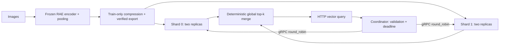

# RAE Feature Compression & Sharded Retrieval Service

A Python pipeline compresses high-dimensional Representation Autoencoder (RAE) features offline, and a Go service searches the exported vectors online using replicated gRPC shards and an HTTP coordinator. The benchmark measures storage, retrieval quality, correctness, latency, memory and failure behavior; image encoding and compression stay outside the online request path.



| Check | Measured result | Workload and limits |
|---|---|---|
| Exact correctness | 72,000 query checks, 0 ID mismatches | 2,000 unique real queries, four representations, 1/2/4 shards, three repetitions |
| Replica deletion / rolling restart | 0/540 failed requests for each event type | Three eighteen-second windows per event, 10 offered QPS |
| Closed-loop throughput | **1,026 QPS @ 31 ms p99** (rounded medians) | **Synthetic 50k x64 FP32**, two shards x two replicas, four total shard CPUs, eight clients, three six-second windows |
| E6 replica distribution | **160/0 vs 80/80** requests per shard | ClusterIP + pick_first vs headless + round_robin; includes warmup, three trials |

These are single-host Windows/WSL2 kind measurements, not production capacity or
availability guarantees. Trial ranges, limitations and raw artifacts are in
[serving evidence](docs/SERVING_EVIDENCE.md) and the
[measurement index](benchmarks/serving/README.md).

The project extracts one pooled feature vector per image from the official frozen RAE Stage-1 model, fits several compression methods on the training split, evaluates them on fixed validation/test splits, and writes machine-readable results plus a Markdown report. It is a feature-system benchmark, not a full Diffusion Transformer trainer.

## Why this exists

The DINOv2-B RAE emits a 768-channel spatial representation. Persisting and searching many full-precision vectors has a measurable storage and compute cost. This benchmark answers a practical question: which representation is the smallest one that remains within a configured validation-quality tolerance?

## Pipeline

```text
CIFAR-10 images
    -> official frozen RAE encoder
    -> spatial mean pooling [B, 768]
    -> train-only centering
    -> FP32 / FP16 storage / PCA / linear adapter
    -> exact block cosine search + logistic probe + reconstruction metrics
    -> validation-only recommendation + test audit
```

Each run is content-addressed from its configuration. Atomic JSON/NPZ writes, manifest checks, sample IDs, dataset/checkpoint hashes, and explicit result statuses prevent partial or stale artifacts from being presented as completed measurements.

## Quick start

Python 3.10 or newer is required.

```bash
git clone https://github.com/xiaorui7/rae-feature-compression-benchmark.git
cd rae-feature-compression-benchmark
python -m venv .venv
```

On Windows PowerShell:

```powershell
.\.venv\Scripts\Activate.ps1
python -m pip install -e ".[dev]"
featurebench smoke
pytest -q
```

On macOS or Linux, activate with `source .venv/bin/activate`. The smoke profile uses synthetic data and does not download model weights; its results are labeled `synthetic` and are only an end-to-end health check.

## Running a real benchmark

Real extraction requires the upstream [bytetriper/RAE](https://github.com/bytetriper/RAE) repository, its Stage-1 DINOv2-B assets, and the CIFAR-10 Python archive. These large third-party files are intentionally not committed here.

1. Clone the official repository into `official_RAE/` and install its requirements.
2. Place the CIFAR-10 archive under `data/` so `torchvision.datasets.CIFAR10(..., download=False)` can load it.
3. Confirm the paths in `configs/featurebench_pilot.json`.
4. Run the staged pipeline:

```bash
featurebench extract --config configs/featurebench_pilot.json
featurebench fit --config configs/featurebench_pilot.json
featurebench evaluate --config configs/featurebench_pilot.json
featurebench recommend --run-dir featurebench_runs/<run-id>
featurebench report --run-dir featurebench_runs/<run-id>
```

Use `featurebench run --config ...` to execute the stages in one command. Re-running the same configuration resumes verified artifacts instead of silently changing the protocol.

## Verified example

The checked-in `benchmark_small` report is an actual local measurement on 5,000 train, 1,000 validation, and 2,000 test images. Under its validation-only 2 percentage-point tolerance, PCA-64 was selected:

| Representation | Deployment bytes | Test class P@10 | Exact search median |
|---|---:|---:|---:|
| Full FP32 (768-D) | 15,784,386 | 0.950 | 1.775 s |
| PCA (64-D) | 1,904,296 | 0.954 | 1.343 s |

This run reduced measured serialized deployment storage by 87.9%. Timing is a single-machine benchmark, and class Precision@10 is a coarse CIFAR-10 retrieval proxy. PCA-64 retained only 0.644 neighbor overlap@10 against the full representation, so the recommendation should not be generalized to fine-grained visual search without a task-specific evaluation. See [the complete report](examples/benchmark-small-report.md) and [protocol](docs/protocol.md).

## Online serving

The static Go service searches the
exported vectors. Images are encoded and compressed offline; the online API
accepts vectors and returns neighbor IDs/scores. PyTorch is outside the request
path. The original Python benchmark and measured example above are unchanged.

Search is exact cosine with deterministic score/ID ordering, bounded scoring
concurrency, one alternate-replica retry, a shared overload retry budget, and
explicit partial-result policy. FP16 values stay compressed in server memory.
Prometheus metrics, JSON request IDs, health probes and opt-in pprof support
verification and operation.

Build with Go 1.26.2 (generated protobuf is committed):

```bash
cd serving
go build -o bin/ ./cmd/...
go test ./...
cd ..
```

Docker Compose end-to-end check, after the Python quick start:

```powershell
python -m featurebench smoke
$run = (Get-ChildItem featurebench_runs -Directory -Filter 'smoke-*' | Select-Object -First 1).FullName
python scripts/serving_e2e.py --run-dir $run --methods full_fp32 --shard-counts 2 --compose --output serving_exports/compose-check.json
```

The helper creates a two-shard/two-replica stack, checks the oracle, runs a short
load check and always tears it down. On Linux, pass the smoke directory printed
by `featurebench smoke` as `--run-dir`. Docker CLI/Compose must be available.

For a persistent local kind demo, install kind v0.33.0 and kubectl, then:

```powershell
$export = python -m featurebench export-synthetic --count 50000 --dim 64 --dtype float32 --shards 2 --seed 42 --query-count 64 --out serving_exports
python scripts/serving_kind.py up --export $export
python scripts/serving_kind.py verify
kubectl --context kind-rae-serving -n rae-serving port-forward service/coordinator 8080:8080 --address 127.0.0.1
```

The export command prints a directory. Bash equivalents are:

```bash
export_dir=$(python -m featurebench export-synthetic --count 50000 --dim 64 --dtype float32 --shards 2 --seed 42 --query-count 64 --out serving_exports)
python scripts/serving_kind.py up --export "$export_dir"
python scripts/serving_kind.py verify
```

`verify` handles its own temporary port-forward and writes an ignored local report. Stop
the manual port-forward with Ctrl+C. `python scripts/serving_kind.py down`
removes only this named demo cluster. See [deployment details](deploy/kind/README.md).

Measured on one Windows/WSL2 Docker host, with three trials per case:

| Check | Observed result | Scope |
|---|---|---|
| Exact correctness | 0 ID mismatches across 72,000 query checks | 2,000 unique actual queries, four representations, 1/2/4 shards, three repetitions |
| Closed-loop load | Median 1,025.77 QPS, 31.125 ms p99 | Synthetic 50k x64, two shards x two replicas, four total shard CPUs, eight clients, three six-second windows |
| FP16 numeric buffers | 49.87% smaller; p99 55.575 vs 32.970 ms | Synthetic 50k x768, same four-CPU quota; decoding trades memory for CPU |
| Replica deletion / rolling restart | 0 failed requests out of 540 for each event type | Three eighteen-second windows per event, 10 offered QPS |
| Replica distribution | 80/80 vs 160/0 | Headless round_robin vs ClusterIP pick_first; includes warmup |

These are local pilots, not production SLA or multi-node scaling claims. Serving
request latency is not directly comparable to the offline batch-search timing
above. Ranges, RSS, negative results, superseded attempts and exact environments
are in [serving evidence](docs/SERVING_EVIDENCE.md) and the
[raw evidence index](benchmarks/serving/README.md).

## Engineering features

- Staged CLI (`extract`, `fit`, `evaluate`, `recommend`, `report`) with resumable, content-addressed run directories.
- Verified manifests and caches with atomic writes, unique sample IDs, shape checks, and provenance hashes.
- Common compressor interface for identity FP32, FP16 storage, PCA, and trainable linear adapters.
- Exact block-wise cosine search with deterministic ID tie-breaking and self-match exclusion.
- Validation-only model selection, paired bootstrap intervals, and a held-out test audit.
- Unit and CLI integration tests plus a CPU GitHub Actions workflow.

## Project structure

```text
featurebench/          CLI, pipeline, compression, evaluation, reporting
configs/               smoke, pilot, and benchmark-small protocols
tests/                 focused unit and end-to-end smoke tests
docs/                  protocol, design decisions, and research boundaries
examples/              checked-in measured report and recommendation
.github/workflows/     Python, Go race/vet/format and Compose CI
serving/               Go shard/coordinator/loadgen/verify, protobuf and Dockerfile
deploy/                Compose and generated kind resources
scripts/serving_*.py    export-to-service verification and repeated measurements
benchmarks/serving/     raw measured results, profiles and retained failed attempts
```

## Boundaries

- The real benchmark depends on official RAE code and weights; this repository does not redistribute them.
- The main representation is a spatially pooled feature vector, not a decodable spatial latent.
- No DiT is trained, and no image-generation FID/KID/IS claim is made.
- Local runtime and memory values are hardware-specific; synthetic smoke results are never treated as research measurements.

## Documentation

- [Project guide](PROJECT_GUIDE.md): architecture, data flow, and implementation guide.
- [Evaluation protocol](docs/protocol.md): exact definitions and measurement boundaries.
- [Design decisions](docs/design.md): trade-offs behind caching, search, and recommendation.
- [Related work and attribution](docs/related_work.md): upstream ownership and research scope.
- [Serving design](docs/SERVING_DESIGN.md): protocol, concurrency, replicas and limits.
- [Serving walkthrough](docs/SERVING_WALKTHROUGH.md): full request path and design questions.

## License

Project code is released under the MIT License. Official RAE code, pretrained weights, and datasets remain subject to their own licenses.

